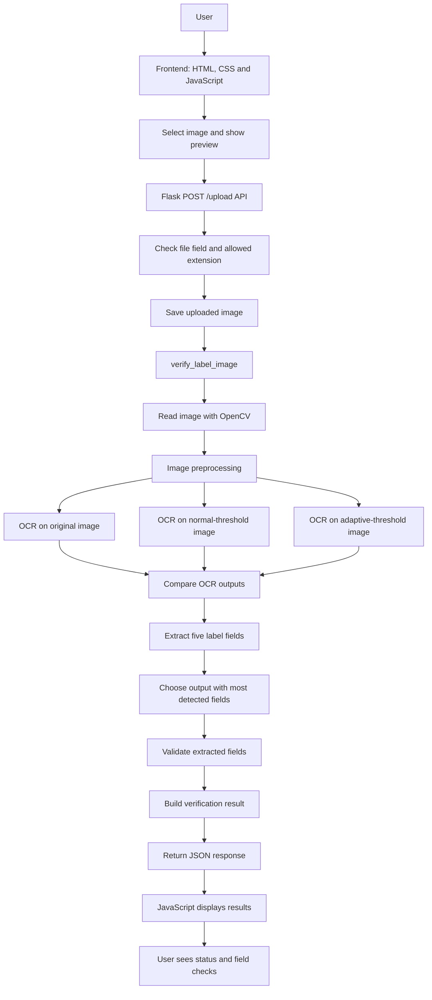
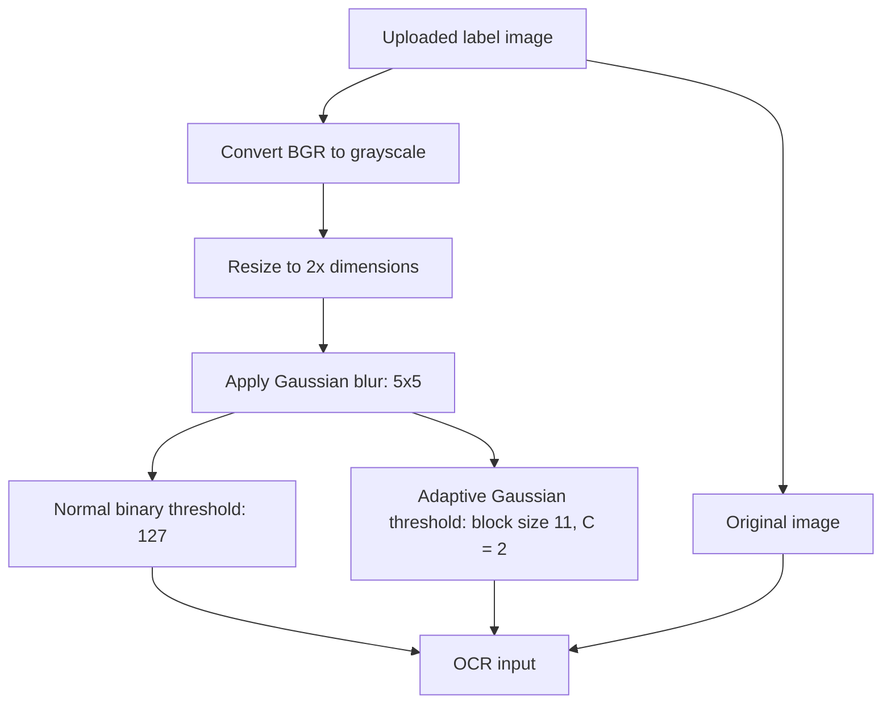

# Excise Label Verification System

An image-based label scanning and verification application that extracts key information from an excise/product label and checks whether the detected values satisfy a set of basic validation rules.

The application provides a browser-based interface for uploading a label image. A Python Flask API receives the image, processes it using OpenCV, extracts text with Tesseract OCR, identifies important label fields, validates those fields, and returns structured JSON results to the frontend.

> **Important:** This project performs OCR-based field extraction and rule-based validation. It does not currently connect to an official excise database, verify a product against a government registry, or establish that a physical product is genuine. A `VALID` result means that the extracted fields passed the validation rules implemented in this project; it is not official product authentication.

## Contents

- [Features](#features)
- [Technology stack](#technology-stack)
- [System architecture](#system-architecture)
- [End-to-end workflow](#end-to-end-workflow)
- [Backend modules](#backend-modules)
- [Image preprocessing](#image-preprocessing)
- [OCR selection strategy](#ocr-selection-strategy)
- [Field extraction](#field-extraction)
- [Validation rules](#validation-rules)
- [Project structure](#project-structure)
- [Installation and setup](#installation-and-setup)
- [Running the application](#running-the-application)
- [API documentation](#api-documentation)
- [Sample response](#sample-response)
- [Dataset and sample images](#dataset-and-sample-images)
- [Current limitations](#current-limitations)
- [Possible future enhancements](#possible-future-enhancements)

## Features

- Upload label images in PNG, JPG, JPEG, and BMP formats.
- Preview the selected image in the browser before verification.
- Preprocess images to improve the readability of printed text.
- Run Tesseract OCR on the original image, normal-threshold image, and adaptive-threshold image.
- Compare OCR outputs by counting how many target fields can be extracted.
- Automatically select the OCR output with the highest detected-field count.
- Extract five label fields:
  - Product Name
  - Batch Number
  - Manufacturing Date
  - Expiry Date
  - MRP (Maximum Retail Price)
- Validate each extracted field using predefined rules.
- Display the overall `VALID` or `INVALID` result and individual field checks in the browser.

## Technology stack

| Layer | Technology | Purpose |
|---|---|---|
| Frontend | HTML5 | Page structure and upload interface |
| Frontend | CSS3 | Layout, styling, image preview and result presentation |
| Frontend | JavaScript | File selection, preview, API request and result rendering |
| Backend | Python | Application and verification logic |
| Backend API | Flask | Receives uploads and returns JSON responses |
| Cross-origin requests | Flask-CORS | Allows the browser frontend to call the Flask API from a different origin |
| Image processing | OpenCV | Grayscale conversion, resizing, blur and thresholding |
| OCR | Tesseract OCR | Converts text visible in the label image into machine-readable text |
| OCR integration | Pytesseract | Python interface for Tesseract OCR |
| Image utilities | Pillow, NumPy | Supporting image-processing dependencies |

## System architecture

The project follows a simple frontend-to-backend architecture. The frontend does not perform OCR itself. It sends the selected image to the Flask backend, where the image-processing and verification pipeline runs.



### Architecture layers

1. **Presentation layer — `frontend/`**  
   Accepts the image, displays its preview, sends the upload request, and presents the verification output.

2. **API layer — `backend/app.py`**  
   Exposes the Flask routes, checks the uploaded file, saves it, invokes the verification function, and returns JSON.

3. **Image-processing layer — `backend/image_processor.py`**  
   Produces grayscale, resized, blurred, normal-threshold, and adaptive-threshold versions of the image.

4. **OCR layer — Tesseract through Pytesseract**  
   Reads text from the original image and the two thresholded image variants.

5. **Extraction layer — `backend/field_extractor.py`**  
   Uses regular expressions and known label-name variations to extract the five target values.

6. **Verification layer — `backend/verification.py` and `backend/validator.py`**  
   Selects the OCR result with the greatest number of detected fields and applies the field-validation rules.

## End-to-end workflow

1. The user opens the frontend and selects a label image.
2. JavaScript checks the file extension and displays a local image preview.
3. When the user clicks **Verify Label**, JavaScript places the file in a `FormData` object under the key `image`.
4. The browser sends a `POST` request to `http://127.0.0.1:5000/upload`.
5. Flask checks that the request contains an image, that a filename was selected, and that the extension is allowed.
6. Flask saves the uploaded image in the operating system's temporary directory under `excise_label_uploads`.
7. `verify_label_image()` reads the image and creates the preprocessed variants.
8. Pytesseract runs OCR on three inputs: the original image, the normal-threshold image, and the adaptive-threshold image.
9. The field extractor runs against each OCR text result. The result with the highest number of non-empty extracted fields is selected.
10. The validator checks the five extracted values and determines the overall status.
11. Flask returns the selected OCR method, detected-field count, OCR text, extracted fields, and validation results as JSON.
12. JavaScript displays the extracted values, individual PASS/FAIL checks, and overall label status.

## Backend modules

### `app.py` — Flask API and upload handling

Responsibilities:

- Creates the Flask application and enables CORS.
- Defines the allowed image extensions: `png`, `jpg`, `jpeg`, and `bmp`.
- Exposes the home route (`GET /`).
- Exposes the upload route (`POST /upload`).
- Checks the uploaded file and sanitizes its filename with Werkzeug's `secure_filename`.
- Saves the image in a temporary upload directory.
- Calls `verify_label_image()` and returns its result as JSON.

### `image_processor.py` — Image preprocessing

The `preprocess_image(image)` function creates five processed versions of the input image:

- **Grayscale:** converts the BGR image to a single-channel grayscale image.
- **Resized:** doubles the width and height using cubic interpolation.
- **Blurred:** applies a 5 × 5 Gaussian blur to reduce small image noise.
- **Normal threshold:** applies binary thresholding with a threshold value of 127.
- **Adaptive threshold:** applies Gaussian adaptive thresholding with a block size of 11 and a constant of 2.

The function returns these images in a dictionary. The main verification pipeline uses the normal-threshold and adaptive-threshold variants in addition to the original image for OCR.

### `ocr_engine.py` — Basic OCR experiment

A standalone script that reads the sample image and runs Tesseract OCR on it. It is useful for testing the OCR installation and inspecting raw OCR output. It is not the main API verification pipeline.

### `ocr_comparison.py` — OCR comparison experiment

A standalone experiment that runs OCR on the original, normal-threshold, and adaptive-threshold images. It compares the outputs against a small, hard-coded set of expected sample-label strings, prints field-match scores, and selects the highest-scoring output.

This script is for experimentation with the supplied sample label. The live application uses the detected-field-count selection strategy in `verification.py`, not the hard-coded expected-text comparison in this script.

### `field_extractor.py` — Structured field extraction

The `extract_fields(ocr_text)` function searches the OCR text for known field labels. It uses case-insensitive, multiline regular expressions and supports several label variations.

| Output field | Recognized label examples |
|---|---|
| Product Name | `PRODUCT NAME`, `BRAND NAME`, `PRODUCT` |
| Batch Number | `BATCH NUMBER`, `BATCH NO`, `LOT NUMBER`, `LOT NO`, `BATCH`, `LOT` |
| Manufacturing Date | `DATE OF MANUFACTURE`, `MANUFACTURING DATE`, `MANUFACTURED ON`, `MFG DATE`, `MFD`, `MFG` |
| Expiry Date | `EXPIRATION DATE`, `EXPIRY DATE`, `EXP DATE`, `USE BEFORE`, `USE BY`, `BEST BEFORE`, `EXP` |
| MRP | `MAXIMUM RETAIL PRICE`, `MRP` |

The extractor looks for a recognized label at the beginning of a line and captures the text after the label and optional colon or hyphen. If a field is not found, its value is `None`.

### `validator.py` — Field and overall validation

Contains the validation functions for product name, batch number, manufacturing date, expiry date, and MRP. See [Validation rules](#validation-rules).

### `verification.py` — Main verification pipeline

The `verify_label_image(image_path)` function coordinates the backend processing:

1. Reads the uploaded image using OpenCV.
2. Returns an error if the image cannot be read.
3. Calls `preprocess_image()`.
4. Runs OCR on the original, normal-threshold, and adaptive-threshold images.
5. Extracts fields from each OCR output.
6. Counts the non-empty extracted fields for each method.
7. Selects the method with the highest count.
8. Validates the selected fields using `validate_label()`.
9. Returns the selected method, detected-field count, OCR text, extracted fields, and validation results.

## Image preprocessing

The purpose of preprocessing is to create alternative image representations that may make printed characters easier for OCR to recognize.



Although the preprocessing function also creates resized and blurred images, the current verification function performs OCR on the original, normal-threshold, and adaptive-threshold images. The resized and blurred images are intermediate preprocessing outputs; they are not independently evaluated by the live OCR-selection step.

## OCR selection strategy

The application runs OCR three times:

| OCR input | Description |
|---|---|
| Original Image | The uploaded image without the threshold transformations |
| Normal Threshold | The binary-threshold version of the preprocessed image |
| Adaptive Threshold | The adaptive-threshold version of the preprocessed image |

For each OCR output, the application extracts the five target fields and counts how many values are non-empty.

**Selection rule:** the OCR output with the largest detected-field count is selected for final validation.

For example, if the original image yields 3 detected fields, normal threshold yields 4, and adaptive threshold yields 5, the adaptive-threshold output is selected.

**Note:** `detected_field_count` is a count of non-empty extracted fields, not a percentage OCR accuracy score. If two methods have the same count, Python's `max()` selection follows the order in which the methods were inserted into the score dictionary: Original Image, Normal Threshold, Adaptive Threshold.

## Field extraction

The selected OCR text is converted into a structured dictionary containing:

```json
{
  "Product Name": "TEST WHISKY",
  "Batch Number": "B12345",
  "Manufacturing Date": "1-10-2026",
  "Expiry Date": "1-10-2028",
  "MRP": "750"
}
```

The values above illustrate the sample format used by the project's extraction logic; actual values depend on the uploaded image and OCR output. A missing field is returned as `null` in JSON.

## Validation rules

The application applies the following checks:

| Field | Rule | PASS condition |
|---|---|---|
| Product Name | `validate_product_name()` | Value exists and is not empty after trimming whitespace |
| Batch Number | `validate_batch_number()` | Value exists and is not empty after trimming whitespace |
| Manufacturing Date | `validate_mfg_date()` | Value can be parsed using one of the supported date formats |
| Expiry Date | `validate_expiry_date()` | Both dates can be parsed and expiry date is later than manufacturing date |
| MRP | `validate_mrp()` | Value can be converted to a number and is greater than zero |

Supported date formats:

- `DD-MM-YYYY`
- `DD/MM/YYYY`
- `DD.MM.YYYY`
- `YYYY-MM-DD`

The overall status is:

- **VALID:** all five individual checks return `true`.
- **INVALID:** one or more individual checks return `false`.

The current expiry-date rule checks that the expiry date is later than the manufacturing date. It does not check whether the expiry date is later than today's date. The current MRP rule checks that the value is positive; it does not compare the price with an external source.

## Project structure

```text
lablescanning/
│
├── backend/
│   ├── app.py                    # Flask API and image upload route
│   ├── image_processor.py        # Image preprocessing functions
│   ├── ocr_engine.py             # Standalone OCR test
│   ├── ocr_comparison.py         # Standalone OCR comparison experiment
│   ├── field_extractor.py        # Extracts structured label fields
│   ├── validator.py              # Validates extracted values
│   ├── verification.py           # Main end-to-end verification pipeline
│   └── uploads/                  # Sample/test upload files
│
├── frontend/
│   ├── index.html                # User interface
│   ├── style.css                 # Frontend styling
│   └── script.js                 # Preview, upload and result rendering
│
├── dataset/
│   ├── raw_images/               # Sample input images
│   └── processed_images/         # Saved preprocessing examples
│
├── models/                       # Reserved for model files; no model is used by the current pipeline
├── tests/                        # Test directory; no automated test suite is currently included
├── uploads/                      # Project-level upload directory; current API uses a system temp directory
├── requirements.txt              # Python dependencies
└── README.md
```

Generated virtual-environment files and Python cache files should not be committed to source control.

## Installation and setup

### 1. Prerequisites

Install the following:

- Python 3.9 or later (Python 3.10 is suitable).
- Tesseract OCR.
- Git (optional, for cloning the repository).
- A modern web browser.

### 2. Install Tesseract OCR

Install Tesseract OCR for your operating system and confirm that the executable is available.

On Windows, the project currently specifies this path in both `backend/verification.py` and `backend/ocr_engine.py`:

```python
pytesseract.pytesseract.tesseract_cmd = r"C:\Program Files\Tesseract-OCR\tesseract.exe"
```

If Tesseract is installed elsewhere, update the path in those files to match your installation. On macOS or Linux, configure the executable path appropriate to that system (or use the executable available on `PATH`). The current hard-coded Windows path must not be assumed to work unchanged on every operating system.

### 3. Get the project

If using Git:

```bash
git clone <your-repository-url>
cd lablescanning
```

Alternatively, extract the downloaded project ZIP and open a terminal in the extracted `lablescanning` directory.

### 4. Create and activate a virtual environment

**Windows PowerShell:**

```powershell
python -m venv .venv
.venv\Scripts\Activate.ps1
```

If PowerShell blocks activation, use Command Prompt:

```bat
.venv\Scripts\activate.bat
```

**macOS / Linux:**

```bash
python3 -m venv .venv
source .venv/bin/activate
```

### 5. Install Python dependencies

From the project root, run:

```bash
pip install -r requirements.txt
pip install flask-cors
```

`Flask-CORS` is required by `backend/app.py` but is not currently listed in the supplied `requirements.txt`; install it separately using the command above. It should be added to `requirements.txt` for reproducible setup.

## Running the application

### 1. Start the Flask backend

Open a terminal, activate the virtual environment, and move into the backend directory:

```bash
cd backend
python app.py
```

The API starts at:

```text
http://127.0.0.1:5000
```

The home route can be checked in a browser:

```text
http://127.0.0.1:5000/
```

Expected response:

```text
Excise Label Verification System API is Running!
```

Keep this terminal running while using the frontend.

### 2. Start the frontend

Open a second terminal. From the project root, serve the frontend directory using Python's built-in HTTP server:

```bash
python -m http.server 5500 --directory frontend
```

Open the frontend in your browser:

```text
http://127.0.0.1:5500
```

You can also open `frontend/index.html` directly, but serving it over HTTP is the recommended approach for local development.

### 3. Verify a label

1. Select a PNG, JPG, JPEG, or BMP label image.
2. Confirm that the image preview appears.
3. Click **Verify Label**.
4. Wait for the backend to complete preprocessing, OCR, extraction, and validation.
5. Review the overall status, extracted field values, individual field checks, selected OCR method, and detected-field count.

## API documentation

### Health / home route

| Property | Value |
|---|---|
| Method | `GET` |
| URL | `/` |
| Purpose | Confirms that the Flask API is running |

### Upload and verify label

| Property | Value |
|---|---|
| Method | `POST` |
| URL | `/upload` |
| Content type | `multipart/form-data` |
| Form field | `image` |
| Allowed extensions | `.png`, `.jpg`, `.jpeg`, `.bmp` |

Example request using cURL:

```bash
curl -X POST http://127.0.0.1:5000/upload \
  -F "image=@path/to/label.jpg"
```

Successful responses contain:

| Key | Description |
|---|---|
| `message` | Upload and verification message |
| `filename` | Sanitized uploaded filename |
| `selected_method` | OCR input selected by detected-field count |
| `detected_field_count` | Number of non-empty fields extracted from the selected OCR result |
| `ocr_text` | OCR text from the selected method |
| `extracted_fields` | Structured values for the five target fields |
| `validation` | Individual boolean checks and overall label status |

Possible upload errors include:

- `400`: no image was included in the request.
- `400`: no file was selected.
- `400`: the file extension is not supported.
- `400`: the uploaded image could not be read or processed.

## Sample response

The following is an illustrative response showing the response structure. Actual OCR output and field values depend on the uploaded image.

```json
{
  "message": "Image uploaded and verified successfully",
  "filename": "sample_label.jpg",
  "selected_method": "Adaptive Threshold",
  "detected_field_count": 5,
  "ocr_text": "PRODUCT NAME: TEST WHISKY\nBATCH NO: B12345\nMFG DATE: 1-10-2026\nEXP DATE: 1-10-2028\nMRP: 750",
  "extracted_fields": {
    "Product Name": "TEST WHISKY",
    "Batch Number": "B12345",
    "Manufacturing Date": "1-10-2026",
    "Expiry Date": "1-10-2028",
    "MRP": "750"
  },
  "validation": {
    "Product Name": true,
    "Batch Number": true,
    "Manufacturing Date": true,
    "Expiry Date": true,
    "MRP": true,
    "Label Status": "VALID"
  }
}
```

## Dataset and sample images

The repository contains sample label images in `dataset/raw_images/` and example processed images in `dataset/processed_images/`. The preprocessing script can be run independently from the project root using:

```bash
python backend/image_processor.py
```

The standalone OCR and comparison scripts contain Windows-specific Tesseract configuration and sample-image paths. Check those paths before running them from a different working directory or operating system.

## Current limitations

- OCR quality depends on image resolution, focus, lighting, orientation, print quality, and label layout.
- The extractor expects recognized field labels near the beginning of a line. Unusual layouts or OCR errors may prevent a field from being extracted.
- OCR selection is based on the number of non-empty extracted fields, not confidence scores or verified ground-truth accuracy.
- Date validation supports only the four formats listed above.
- The application does not currently validate expiry against the current date.
- The application does not verify batch numbers, product names, or MRP against an official database.
- The upload API currently checks file extensions but does not implement file-size limits, content-based file-type validation, authentication, or rate limiting.
- The upload directory uses the original sanitized filename, so repeated uploads with the same filename may overwrite an earlier file.
- The Tesseract executable path is hard-coded for a typical Windows installation.
- The repository currently contains no automated test cases in the `tests/` directory.

## Possible future enhancements

- Add OCR confidence-based selection alongside detected-field counts.
- Improve extraction for multiple label layouts, multiline values, and OCR character errors.
- Add stronger date parsing and check whether a product is already expired.
- Add image rotation, perspective correction, denoising, and illumination correction.
- Validate label information against an authorized product or excise database, where an approved data source is available.
- Add upload size limits, content-type checks, unique filenames, and automatic cleanup of temporary files.
- Move Tesseract configuration into environment variables or application settings.
- Add automated unit tests for field extraction, date parsing, validation, and API responses.
- Add persistent verification history and downloadable verification reports if required.

---

**Project:** Excise Label Verification System  
**Core pipeline:** Image Upload → Preprocessing → OCR → Field Extraction → Rule-Based Validation → Result Display
